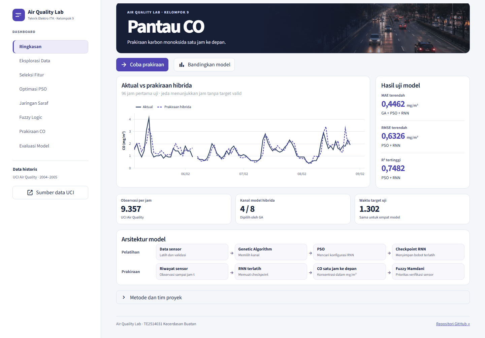

<div align="center">

# Air Quality Lab

**Pantau CO · Prakiraan karbon monoksida satu jam ke depan**

TE2514031 Kecerdasan Buatan · Teknik Elektro ITK · Kelas B · Kelompok 9 · Gasal 2026/2027

[**Buka dashboard Streamlit**](https://tubes-kecebut-kel9.streamlit.app/) · [Notebook eksperimen](Forecasting_CO_Kelompok_9.ipynb) · [Panduan demo UAS](docs/VALIDASI_DAN_DEMO_UAS.md)

</div>

[](https://tubes-kecebut-kel9.streamlit.app/)

Pantau CO menggunakan riwayat sensor kimia, suhu, dan kelembapan untuk memprakirakan konsentrasi karbon monoksida (CO) satu jam setelah pengamatan terakhir. Sumbernya adalah 9.357 pengamatan per jam dari satu lokasi pada 2004–2005. [UCI Air Quality](https://doi.org/10.24432/C59K5F)

Pada **Ringkasan**, grafik interaktif menampilkan nilai CO aktual dan prakiraan hibrida pada 96 jam pertama periode uji. Diagram di bawah grafik memperlihatkan alur pelatihan dan prakiraan.

## Coba prakiraan

1. Buka **Prakiraan CO** dan pilih **GA + PSO + RNN**.
2. Pada **Input manual**, klik **Hitung prakiraan** untuk menjalankan contoh historis. Untuk 5 Februari 2005 pukul 03.00, hasilnya **1,492 mg/m³**, dengan CO aktual **1,600 mg/m³** dan prioritas pemeriksaan sensor **Terpantau**.
3. Edit riwayat sensor atau buka **Unggah CSV** dan unduh contoh sesuai model. Gunakan baris berurutan per jam dengan timestamp lokal tanpa zona waktu. Sel kosong atau kode `-200` menandai pembacaan yang hilang.
4. Periksa kelengkapan dan pembacaan di luar rentang latih, lalu unduh hasil prakiraan sebagai CSV. Model memerlukan setidaknya satu pembacaan tiap kanal wajib dalam empat jam terakhir.

Menu **Eksplorasi Data**, **Seleksi Fitur**, dan **Optimasi PSO** menampilkan proses eksperimen. **Jaringan Saraf** menampilkan kurva pelatihan dan residual, sementara **Evaluasi Model** membandingkan kinerja empat model. **Fuzzy Logic** memperlihatkan cara konsentrasi CO diterjemahkan menjadi prioritas pemeriksaan sensor.

## Metode dan hasil

Data dibagi kronologis 70% latih, 15% validasi, dan 15% uji. Median imputasi dan parameter standardisasi dihitung dari bagian latih. Genetic Algorithm (GA) memilih subset fitur dan Particle Swarm Optimization (PSO) mencari hiperparameter menggunakan bagian validasi. Empat konfigurasi RNN dilatih terpisah dan dievaluasi pada 1.302 waktu target yang sama.

| Model | Fitur | MAE (mg/m³) ↓ | RMSE (mg/m³) ↓ | R² ↑ |
|:---|---:|---:|---:|---:|
| RNN dasar | 8 | 0,4721 | 0,6404 | 0,7419 |
| GA + RNN | 4 | 0,4569 | 0,6518 | 0,7326 |
| PSO + RNN | 8 | 0,4506 | **0,6326** | **0,7482** |
| GA + PSO + RNN | 4 | **0,4462** | 0,6363 | 0,7452 |
| Persistensi | CO terakhir | 0,5060 | 0,7764 | 0,6206 |

Model hibrida memperoleh MAE terendah dengan empat fitur. PSO + RNN memperoleh RMSE terendah dan R² tertinggi. Angka berasal dari [bundle eksperimen](artifacts/uci-v1/experiment.json).

Fuzzy Mamdani memakai keluaran RNN untuk menentukan skor internal prioritas pemeriksaan sensor. Rentang prakiraan memakai persentil ke-90 galat absolut pada validasi sebagai referensi historis. Interpretasikan hasil dalam konteks lokasi, instrumen, dan periode dataset.

## Jalankan secara lokal

Gunakan Python 3.11 atau 3.12. Clone repositori, lalu jalankan perintah dari folder proyek.

```bash
git clone https://github.com/04231043/tubes-kecebut-kel9.git
cd tubes-kecebut-kel9
python -m venv .venv
```

Aktifkan lingkungan dengan `./.venv/Scripts/Activate.ps1` di PowerShell atau `source .venv/bin/activate` di macOS dan Linux.

```bash
python -m pip install -r requirements.txt
python -m streamlit run app.py
```

Dashboard memakai empat checkpoint yang sudah ada di `artifacts/uci-v1/`. Setelah dependensi terpasang, inferensi dengan bundle bawaan dapat berjalan luring.

## Reproduksi dan pengujian

```bash
python -m unittest -v test_pipeline test_dashboard
python train.py --out runs/eksperimen-1
```

Pelatihan default mengambil CSV resmi UCI. Jika CSV sudah tersedia secara lokal, tambahkan `--csv AirQualityUCI.csv`. Gunakan folder keluaran baru pada setiap eksperimen.

| Bagian | Isi |
|:---|:---|
| [Dashboard](app.py) | Eksplorasi, evaluasi, simulasi fuzzy, dan antarmuka prediksi |
| [Pelatihan](train.py) | Pembagian data, pencarian GA/PSO, empat RNN, dan evaluasi |
| [Inferensi](inference.py) | Validasi riwayat sensor, prakiraan, dan referensi galat |
| [Artefak bawaan](artifacts/uci-v1/) | Checkpoint NPZ, statistik, prediksi uji, dan manifest SHA-256 |
| [Notebook](Forecasting_CO_Kelompok_9.ipynb) | Reproduksi eksperimen di Colab |
| [Validasi dan demo](docs/VALIDASI_DAN_DEMO_UAS.md) | Protokol, rincian metrik, dan skenario presentasi |

## Deploy di Streamlit Community Cloud

Pilih repositori `04231043/tubes-kecebut-kel9`, cabang `main` dan entry point `app.py`. Gunakan Python 3.12 serta sertakan `requirements.txt`, `.streamlit/`, dan bundle lengkap `artifacts/uci-v1/`. Setelah deploy, buka **Prakiraan CO** dan periksa contoh manual serta unggahan CSV. [Panduan Streamlit Community Cloud](https://docs.streamlit.io/deploy/streamlit-community-cloud/deploy-your-app/deploy)

## Kelompok 9

| Nama | NIM |
|:---|:---|
| Ariyo Arianto | 04231013 |
| Jhosua George Kamagi | 04231043 |
| Vandri Afli Navi Almas | 04231089 |
| Bernadt Jansen Rajagukguk | 04221062 |

Pengembangan berawal dari [repositori proyek kelompok](https://github.com/vandrialmas/air-quality-streamlit-kelompok9).
